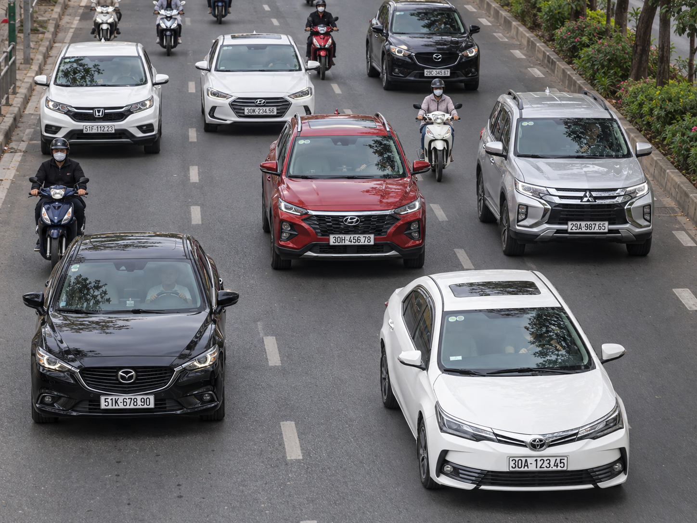
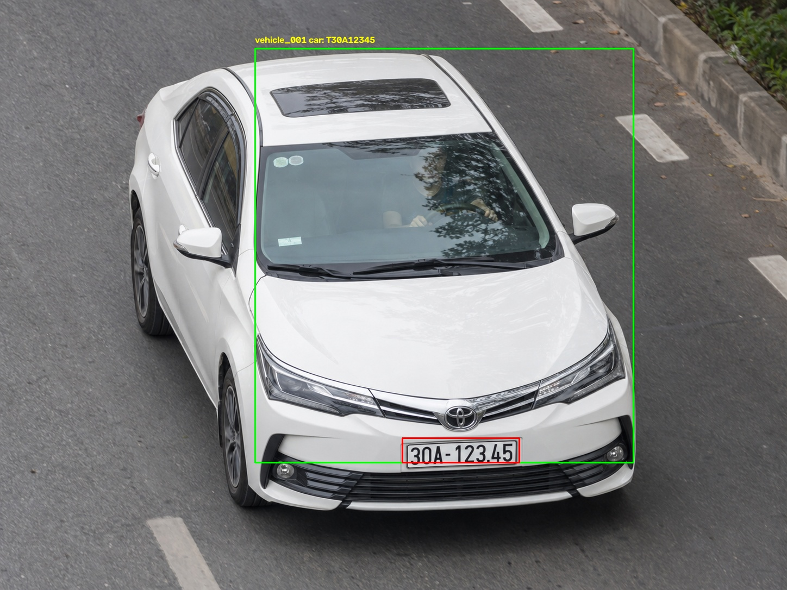
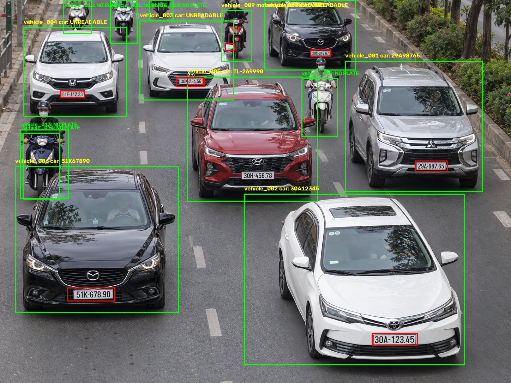
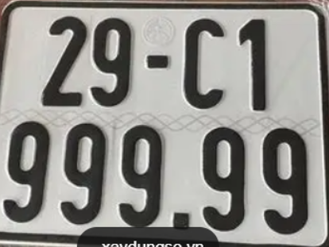
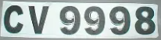
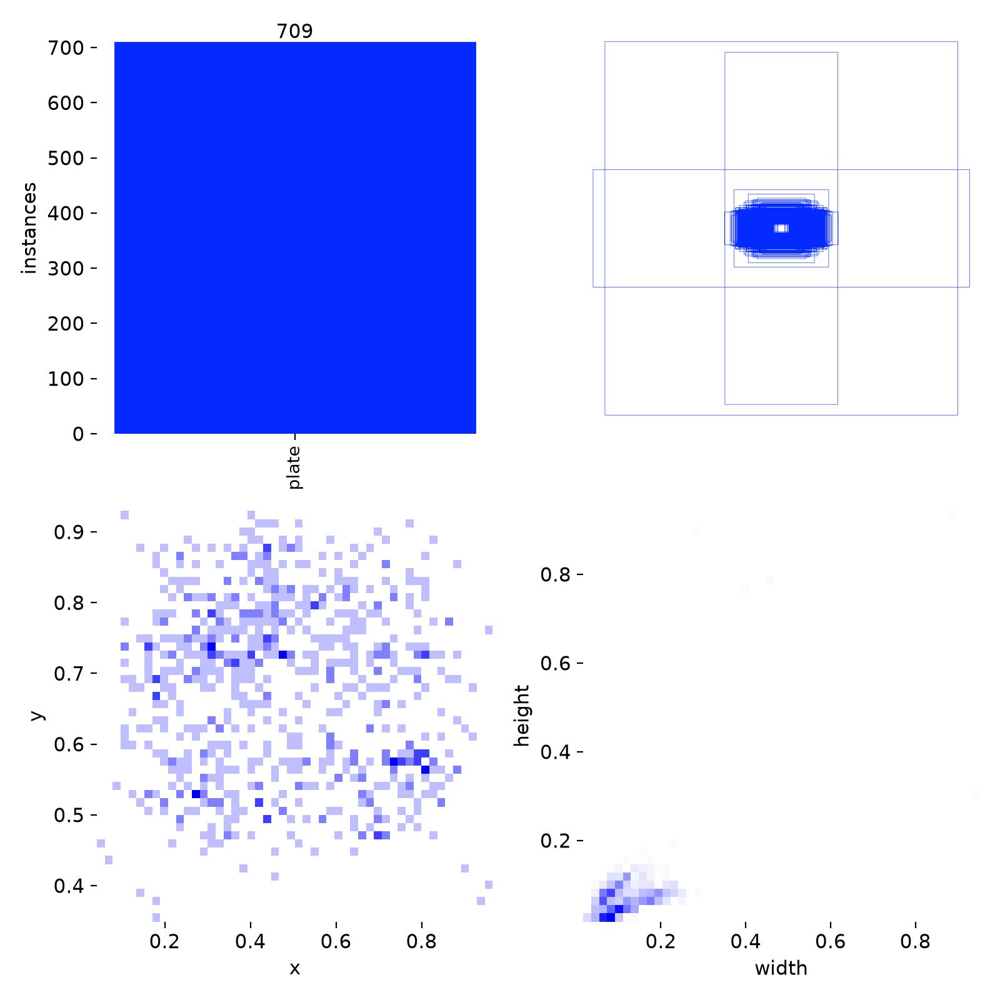
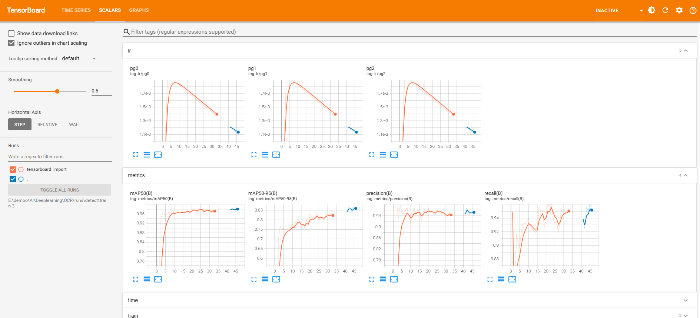

# TrafficVision-AI

<p align="center">
  <b>Vehicle Detection · License Plate Detection · Optical Character Recognition</b>
</p>

TrafficVision-AI is a computer vision project that detects vehicles in traffic images, detects license plates inside each vehicle crop, and attempts to recognize plate characters using Tesseract OCR. It combines Ultralytics YOLO, OpenCV, and Tesseract in a multi-stage inference pipeline.

<p align="center">
  
</p>

## Table of Contents

- [Overview](#overview)
- [Features](#features)
- [Demo and Project Results](#demo-and-project-results)
- [Training Metrics](#training-metrics)
- [TensorBoard](#tensorboard)
- [System Architecture](#system-architecture)
- [Project Structure](#project-structure)
- [Dataset](#dataset)
- [Installation](#installation)
- [Training](#training)
- [Inference](#inference)
- [Docker Setup and Usage](#docker-setup-and-usage)
- [Output Files](#output-files)
- [Troubleshooting](#troubleshooting)
- [Future Improvements](#future-improvements)

---

## Overview

The current pipeline processes a traffic image in several stages:

1. Detect vehicles using the pretrained `yolo26n.pt` model.
2. Keep detections for cars, motorcycles, buses, and trucks.
3. Crop each detected vehicle from the original image.
4. Run a custom-trained YOLO model to detect a license plate inside each vehicle crop.
5. Select the highest-confidence plate detection for each vehicle.
6. Estimate whether the plate has one line or two lines based on its aspect ratio.
7. Preprocess the plate crop and run Tesseract OCR.
8. Save an annotated image, vehicle and plate crops, and a text report.

**Detection and OCR are separate tasks:** YOLO finds the plate location; Tesseract attempts to read the characters. An OCR result can be empty or incorrect even when a plate has been detected.

## Features

- Vehicle detection for cars, motorcycles, buses, and trucks.
- Custom YOLO license plate detection.
- Tesseract OCR with an alphanumeric character whitelist.
- Separate handling for single-line and two-line plate layouts.
- Grayscale conversion, image upscaling, and border padding for OCR.
- Saving vehicle crops, plate crops, annotated images, and text reports.
- Training and resume-training scripts.
- TensorBoard logging and CSV-to-TensorBoard conversion.
- Docker image for the inference pipeline.

---

## Demo and Project Results

### 1. Traffic Detection

<p align="center">
  
  
</p>

### 2. License Plate Examples

<p align="center">
  
  
</p>

### 3. Example Inference Results

The committed output reports show the following results for the example images.

| Input Image | Vehicles Detected | OCR_OK | OCR_EMPTY | PLATE_NOT_DETECTED |
|---|---:|---:|---:|---:|
| `gt1.png` | 1 | 1 | 0 | 0 |
| `gt2.png` | 14 | 4 | 4 | 6 |
| **Total** | **15** | **5** | **4** | **6** |

Example recognized plate texts include:

- `T30A12345`
- `29A98765`
- `30A12345`
- `51K67890`
- `TL-269990`

These are outputs from the current saved inference reports, not a formal accuracy evaluation. OCR text should be checked against ground-truth annotations before calculating recognition accuracy.

View the detailed outputs:

- [Results for gt1](outputs/gt1/result.txt)
- [Results for gt2](outputs/gt2/result.txt)

---

## Training Metrics

The repository includes training metrics in [`runs/detect/train-3/results.csv`](runs/detect/train-3/results.csv).

The currently committed CSV contains records through **epoch 50**. Although the training script is configured for 100 epochs, this snapshot alone does not establish that all 100 epochs were completed.

### Metrics at the Last Recorded Epoch

| Metric | Epoch 50 |
|---|---:|
| Precision (B) | 95.43% |
| Recall (B) | 95.85% |
| mAP@50 (B) | 98.45% |
| mAP@50–95 (B) | 86.13% |

### Best Values in the Available Training Log

| Metric | Best Recorded Value | Epoch |
|---|---:|---:|
| mAP@50 (B) | 98.66% | 38 |
| mAP@50–95 (B) | 86.67% | 45 |

These metrics evaluate license plate object detection. They are not OCR character accuracy or full license plate recognition accuracy.

### Training Artifacts

<p align="center">
  
</p>

Other training artifacts include:

- [`results.csv`](runs/detect/train-3/results.csv) — epoch-by-epoch metrics.
- [`args.yaml`](runs/detect/train-3/args.yaml) — recorded training configuration.
- [`best.pt`](runs/detect/train-3/weights/best.pt) — best checkpoint saved for this run.
- [`last.pt`](runs/detect/train-3/weights/last.pt) — last checkpoint saved for this run.
- Training batch images and TensorBoard event logs under `runs/detect/train-3/`.

---

## TensorBoard

TensorBoard is used to visualize training metrics over time.

### TensorBoard Dashboard

<p align="center">
  
</p>

The image above is a static screenshot. To explore the charts interactively, run TensorBoard locally.

### Option 1: Use Existing TensorBoard Logs

Run the following command from the project root:

```bash
tensorboard --logdir runs/detect/train-3/tensorboard_import --port 6006
```

Open the dashboard in your browser:

**http://127.0.0.1:6006**

### Option 2: Generate Logs from `results.csv`

If the TensorBoard event files are missing or you want to regenerate them, run:

```bash
python csv_to_tensorboard.py
```

The script reads:

```text
runs/detect/train-3/results.csv
```

and writes scalar events to:

```text
runs/detect/train-3/tensorboard_import/
```

Then start TensorBoard:

```bash
tensorboard --logdir runs/detect/train-3/tensorboard_import --port 6006
```

**Note:** The current conversion script is configured for the `train-3` run. Update its paths if your training output is stored elsewhere.

---

## System Architecture

### Detection and Recognition Pipeline

```text
Traffic Image
     |
     v
YOLO Vehicle Detector (yolo26n.pt)
     |
     v
Filter Vehicle Classes
(car / motorcycle / bus / truck)
     |
     v
Crop Each Vehicle
     |
     v
YOLO License Plate Detector (best.pt)
     |
     v
Crop License Plate
     |
     v
Estimate Plate Layout
(Single-Line / Two-Line)
     |
     v
Image Preprocessing
(Grayscale, Resize, White Border)
     |
     v
Tesseract OCR
     |
     v
Annotated Image + Crops + result.txt
```

### Models Used

| Component | Purpose |
|---|---|
| `yolo26n.pt` | Detects vehicles using pretrained COCO classes |
| `best.pt` | Custom-trained license plate detector |
| Tesseract OCR | Recognizes alphanumeric characters from plate crops |

The vehicle detector filters COCO class IDs `2`, `3`, `5`, and `7`, corresponding to car, motorcycle, bus, and truck.

The custom license plate detector is trained on a single class: `plate`.

### OCR Strategy

The `deploy.py` script enlarges each plate crop, converts it to grayscale, adds a white border, and runs Tesseract with an alphanumeric character whitelist.

- **Single-line plate:** OCR is applied to the full crop using page segmentation mode 7.
- **Two-line plate:** The crop is split into upper and lower sections, and OCR is applied to each section using page segmentation mode 8.

The layout decision is based on the plate's width-to-height ratio. This is a heuristic and may need adjustment for different plate formats, camera angles, and image quality.

---

## Project Structure

```text
TrafficVision-AI/
├── Dockerfile
├── .gitignore
├── yolo26n.pt
├── deploy.py
├── train_Detect_Licence_plate.py
├── train_Resume_Model_Detect_Licence_Plate.py
├── test_model.py
├── testYOLO26.py
├── test_plate_1lines.py
├── test_plate_2lines.py
├── visualize_label.py
├── csv_to_tensorboard.py
├── ocr_result.jpg
├── licence plate/
│   ├── data.yaml
│   ├── README.dataset.txt
│   └── README.roboflow.txt
├── picture/
│   ├── gt1.png
│   ├── gt2.png
│   ├── plate_car1.PNG
│   ├── plate_car2.PNG
│   └── tensorboard.PNG
├── outputs/
│   ├── gt1/
│   │   ├── annotated.jpg
│   │   ├── result.txt
│   │   ├── plates/
│   │   └── vehicles/
│   └── gt2/
│       ├── annotated.jpg
│       ├── result.txt
│       ├── plates/
│       └── vehicles/
└── runs/
    └── detect/
        └── train-3/
            ├── args.yaml
            ├── results.csv
            ├── labels.jpg
            ├── tensorboard_import/
            └── weights/
                ├── best.pt
                └── last.pt
```

The large dataset folders (`licence plate/train/`, `valid/`, and `test/`) are excluded from Git by `.gitignore`. Download the dataset separately before training.

---

## Dataset

The project uses a license plate dataset exported from Roboflow.

- **Dataset:** [License Plate — Roboflow Universe](https://universe.roboflow.com/computer-vision-m1xzb/licence-plate-khvsj/dataset/2)
- **Export format:** YOLO
- **Version:** 2
- **Number of images:** 990, according to the included Roboflow metadata
- **Class:** `plate`
- **License:** CC BY 4.0, according to the included metadata

Please consult the dataset page for current license terms and attribution requirements before redistributing the dataset.

### Dataset Structure

After downloading and extracting the dataset, the expected structure is:

```text
licence plate/
├── data.yaml
├── train/
│   ├── images/
│   └── labels/
├── valid/
│   ├── images/
│   └── labels/
└── test/
    ├── images/
    └── labels/
```

YOLO detection labels use the following format:

```text
class_id x_center y_center width height
```

The center coordinates and bounding box dimensions are normalized relative to the image width and height.

### Configure `data.yaml`

The committed `licence plate/data.yaml` contains an absolute Windows path from the development machine. Update the `path:` value to match your local dataset root before training.

Example:

```yaml
path: 'E:/path/to/TrafficVision-AI/licence plate'
train: train/images
val: valid/images
test: test/images

names:
  0: plate
```

Replace the example path with the actual path on your computer.

When training inside Docker, `path:` must point to the dataset location **inside the container**, not the Windows host path.

---

## Technologies

| Technology | Purpose |
|---|---|
| Python | Main programming language |
| Ultralytics YOLO | Vehicle and license plate detection |
| PyTorch | Deep learning framework |
| OpenCV | Image processing, cropping, and visualization |
| Tesseract OCR | License plate text recognition |
| `pytesseract` | Python wrapper for Tesseract |
| TensorBoard | Training metric visualization |
| Matplotlib | Label visualization |
| Docker | Containerized inference environment |

---

## Installation

### 1. Clone the Repository

```bash
git clone https://github.com/thanhdinh2x-hub/TrafficVision-AI.git
cd TrafficVision-AI
```

### 2. Create a Virtual Environment

On Windows PowerShell:

```powershell
python -m venv .venv
.\.venv\Scripts\Activate.ps1
```

### 3. Install Python Dependencies

```bash
pip install ultralytics opencv-python pytesseract tensorboard matplotlib
```

For GPU training, install a PyTorch build compatible with your NVIDIA driver, GPU, Python version, and CUDA setup.

Refer to the [official PyTorch installation guide](https://pytorch.org/get-started/locally/).

### 4. Install Tesseract OCR

`pytesseract` is a Python wrapper. The Tesseract executable must also be installed.

- **Windows:** The scripts expect `C:\Program Files\Tesseract-OCR\tesseract.exe`. Update the path if your installation differs.
- **Docker/Linux:** The included Dockerfile installs `tesseract-ocr`, and `deploy.py` expects `/usr/bin/tesseract`.

---

## Training

Before training, download the dataset and update `licence plate/data.yaml`.

### Train the License Plate Detector

```bash
python train_Detect_Licence_plate.py
```

Current training settings:

| Parameter | Value |
|---|---:|
| Starting checkpoint | `yolo26n.pt` |
| Epochs | 100 |
| Image size | 640 |
| Batch size | 16 |
| Device | GPU 0 (`device=0`) |
| DataLoader workers | 0 |

The script saves training artifacts under `runs/detect/`.

If a run with the requested name already exists, Ultralytics may create a new numbered run directory.

If you do not have a compatible NVIDIA GPU, change `device=0` to `device="cpu"` in the training script. CPU training will usually be much slower.

### Resume Training

```bash
python train_Resume_Model_Detect_Licence_Plate.py
```

The current resume script expects:

```text
runs/detect/train-3/weights/last.pt
```

It also points TensorBoard to:

```text
runs/detect/train-3/tensorboard_import/
```

If the checkpoint or log files are stored in another run directory, update the corresponding paths in the script before running it.

---

## Inference

The main deployment script performs vehicle detection, plate detection, OCR, and result export.

### Run with the Default Image

```bash
python deploy.py
```

The default input image is `picture/gt2.png`.

### Run with Another Image

```bash
python deploy.py --image picture/gt1.png
```

Or provide an absolute path:

```powershell
python deploy.py --image "E:\path\to\traffic_image.jpg"
```

The script expects these model files:

```text
yolo26n.pt
runs/detect/train-3/weights/best.pt
```

The script opens an OpenCV display window at the end. In a headless server or container, the display calls may need to be disabled.

---

## OCR Experiments

The repository contains separate scripts for testing OCR on plate images.

### Single-Line Plate

```bash
python test_plate_1lines.py
```

This script uses `picture/plate_car2.PNG`.

### Two-Line Plate

```bash
python test_plate_2lines.py
```

This script uses `picture/plate_car1.PNG` and saves a visualization to `ocr_result.jpg`.

Both scripts contain a Windows Tesseract executable path. Update it if needed.

---

## Docker Setup and Usage

The current `Dockerfile` uses a PyTorch CUDA runtime image, installs OpenCV and Tesseract dependencies, and copies `runs/`, `picture/`, `yolo26n.pt`, and `deploy.py` into the image.

**The current Dockerfile is designed for inference, not for training.** It does not copy the training scripts or dataset folders into the image.

### 1. Prerequisites

- Docker Desktop running with Linux containers.
- NVIDIA drivers and Docker GPU support if using a GPU.
- The repository files and trained checkpoint.

Check the NVIDIA driver on Windows:

```powershell
nvidia-smi
```

### 2. Build the Docker Image

Run from the project root:

```powershell
docker build -t trafficvision-ai .
```

### 3. Run Inference in Docker

```powershell
docker run --rm --gpus all trafficvision-ai python deploy.py --image picture/gt2.png
```

The script writes output to `outputs/` inside the container.

Because `--rm` removes the container when it exits, mount the output directory if you want to retain generated results on your host.

For example:

```powershell
New-Item -ItemType Directory -Force outputs | Out-Null

docker run --rm --gpus all `
  -v "${PWD}/outputs:/workspace/outputs" `
  trafficvision-ai python deploy.py --image picture/gt2.png
```

This mount example assumes the image uses `/workspace` as its working directory. If your Docker configuration uses a different working directory, update the container path accordingly.

### 4. Interactive Mode

To open a shell inside the container:

```powershell
docker run --rm -it --gpus all --entrypoint bash trafficvision-ai
```

Inside the container:

```bash
python deploy.py --image picture/gt2.png
```

If OpenCV cannot open a display window in Docker, run inference locally or disable the `cv2.imshow`, `cv2.waitKey`, and `cv2.destroyAllWindows` calls for headless execution.

---

## Output Files

For an input image named `gt2.png`, `deploy.py` creates an output folder based on the input filename.

```text
outputs/
└── gt2/
    ├── annotated.jpg
    ├── result.txt
    ├── vehicles/
    │   ├── vehicle_001.jpg
    │   └── ...
    └── plates/
        ├── vehicle_001_plate.jpg
        └── ...
```

| Output | Description |
|---|---|
| `annotated.jpg` | Image annotated with vehicle and plate boxes and OCR text |
| `result.txt` | Vehicle details, plate text, and processing status |
| `vehicles/` | Cropped vehicle images |
| `plates/` | Cropped license plate images |

Possible statuses include:

- `PLATE_NOT_DETECTED`
- `OCR_OK`
- `OCR_EMPTY`

`OCR_EMPTY` means a plate crop was processed but no alphanumeric text was returned.

---

## Troubleshooting

| Issue | What to Check |
|---|---|
| Dataset path not found | Update `path:` in `licence plate/data.yaml` and verify that the dataset folders exist |
| Plate checkpoint missing | Check `runs/detect/train-3/weights/best.pt` or update `PLATE_MODEL_PATH` |
| Resume checkpoint missing | Check `runs/detect/train-3/weights/last.pt` or update the resume script |
| Tesseract not found | Install Tesseract and correct `tesseract_cmd` |
| CUDA unavailable | Check NVIDIA drivers, Docker GPU access, and the installed PyTorch build |
| TensorBoard shows no charts | Regenerate logs if needed and point TensorBoard at `runs/detect/train-3/tensorboard_import` |
| OpenCV display error in Docker | Use a GUI-capable environment or disable display calls for headless inference |
| OCR results are inaccurate | Check crop size, blur, lighting, plate angle, and the one-line/two-line heuristic |

---

## Future Improvements

- Evaluate precision, recall, and mAP on a held-out test set.
- Measure OCR character accuracy and full-plate exact-match accuracy.
- Improve robustness to night scenes, motion blur, and angled plates.
- Refine one-line/two-line layout detection.
- Add video-file and live-camera inference.
- Export results to CSV or JSON.
- Make model, dataset, and output paths configurable through command-line arguments.
- Add a pinned `requirements.txt` and automated environment checks.
- Add a headless inference mode for server and Docker deployments.

---

## Author

**Thanh Dinh**

AI / Computer Vision Project

---

Dataset attribution: the included Roboflow metadata identifies the license plate dataset as CC BY 4.0. Review the [dataset page](https://universe.roboflow.com/computer-vision-m1xzb/licence-plate-khvsj/dataset/2) for current terms and attribution requirements.